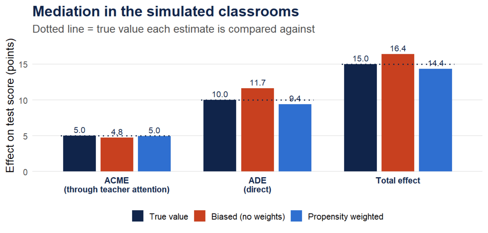
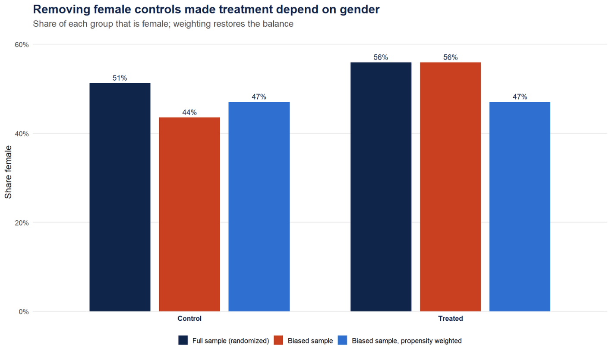
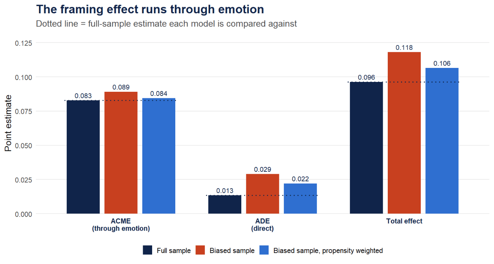

# Understanding Political Emotions via Causal Mediation Analysis
{: .no_toc }

SDS Directed Reading Program, University of Texas at Austin  
**Mentor:** Grace Guinan  
**Tools:** R (`mediation` package), propensity score weighting, LaTeX  
**Links:** [Presentation (PDF)](/assets/images/drp/drp-presentation.pdf)

---
This research started with a curiosity to see if it was possible to understand human behavior and political attitudes via causal analysis.

## Overview

When a news story makes people anxious and then moves them to act, did the story work *through* the emotion, or was something else going on? This project uses causal mediation analysis to answer that. I first built simulated data where the true answer is known, so I could measure exactly how much bias each method introduces. Then I applied the same tools to a real survey experiment on immigration news framing.

## Part 1: Learning the tools on simulated classrooms

**Question:** Does a smaller class raise test scores?

I simulated students with an economic advantage score that raises test scores. In a randomized trial, class size is assigned at random, so the comparison is fair. In an observational setting, more advantaged students are more likely to land in small classes, which creates a backdoor path and biases the estimate.

*Figure 1. In observational data, economic advantage affects both who gets a small class and the test score.*

Because I wrote the data-generating process, I know the true average treatment effect is 10 points. The naive observational estimate was 14, a bias of +4. **Propensity score weighting** (reweighting each student by the inverse probability of their treatment given economic advantage) brought it to 10.3.

| | Randomized | Observational | Propensity weighted |
|---|---|---|---|
| Estimated effect | 10 | 14 | 10.3 |
| Bias | none | +4 | +0.3 |

### Adding a mediator

Next I added **teacher attention** as a mediator: smaller classes raise teacher attention, which raises scores. Mediation splits the total effect into an indirect part and a direct part:

**Total effect = ACME (through the mediator) + ADE (direct)**

*Figure 2. The total effect decomposes into the effect through the mediator and the direct effect.*

*Figure 3. Teacher attention is the mediator. Economic advantage confounds class size and test score.*

*Figure 4. True ACME 5.0, ADE 10.0, total 15.0. The unweighted estimates overstate the direct and total effects (11.7 and 16.4). Weighting recovers the ACME exactly (5.0) and lands close on the rest (9.4 and 14.4).*

**Takeaway:** Confounding inflated the direct and total effects, while weighting corrected most of the bias. The method was not perfect as weighting slightly undershot the direct and total effects.

## Part 2: Using the real survey dataset 

**Question:** Does a news story framed around immigration make people more likely to write to Congress, and is anxiety the reason?

**Data:** the framing experiment from Brader, Valentino and Suhay (2008), distributed with the R `mediation` package.

| Role | Variable | Meaning |
|---|---|---|
| Treatment | `treat` | Assigned a news story with the immigration frame (1) or not (0) |
| Mediator | `emo` | Anxiety score after reading |
| Outcome | `cong_mesg` | Chose to send a message to Congress (0/1) |
| Covariates | age, education, gender, income | Respondent characteristics |

*Figure 5. The causal model for the framing experiment.*

### Stress-testing the method on real data

Because this experiment was randomized, the full-sample estimate is a trustworthy benchmark. To see whether weighting works on real data, I ***deliberately*** made the sample biased by removing female control respondents, so that treatment depended on gender. Then I checked whether propensity weighting recovered the benchmark RCT establishes.

*Figure 6. Removing female controls unbalanced the groups (44% vs 56% female). Weighting restored balance (47% in both).*

*Figure 7. The framing effect runs through emotion.*

### Findings

- **The effect runs mostly through emotion.** In the full randomized sample, the total effect was 0.096. Of that, 0.083 (about 86%) went through the anxiety mediator (ACME) and 0.013 was direct (ADE).
- **The biased sample distorted the picture.** The total effect rose to 0.118 and the direct effect more than doubled to 0.029.
- **Weighting helped, but didn't fully fix it.** The ACME was recovered almost exactly (0.084 vs 0.083), while the direct effect (0.022) and total effect (0.106) moved toward the benchmark without reaching it.

## Limitations

- Propensity weighting adjusts only for the covariates in the model. In the simulation I controlled the confounder, but real data may contain confounders I never observed.
- The biased-sample exercise is an artificial test, so it shows the method's behavior in one controlled setup, not in general.

## What I learned

This project taught me how to validate a method by testing where the answer is known before trusting it on real data. It also made me more careful about the assumptions behind any causal claim, which matters for policy questions where the "why" decides which intervention to try. I had an incredible learning curve with this project and am excited to see where else data science and policy interconnect!

---
